# MDA Restaurant: WhatsApp AI Ordering Assistant

A WhatsApp ordering assistant for a Karachi restaurant, built with **n8n**, **Supabase** and LLM agents.
Customers order in plain language (or by menu number). The owner runs the menu from WhatsApp chat
with a double approval. The menu image redraws itself whenever the menu changes.

<p align="center"></p>

## What it does

**Customer side**
- Orders by chatting: "2 zinger burgers", "number 3", "Family Feast deal". Pickup or delivery (location pin or address), order summary, YES to confirm.
- Live menu on every request: text menu grouped by category with continuous numbering, or the menu image.
- Deals (combos at a fixed price) shown at the top. A deal is ordered as one item.
- Stock aware: "only 8 left", sold out, unavailable today. Ambiguous words ("burger") get a question, never a guess.
- Order status check by order number or phone number.

**Owner side (from WhatsApp)**
- Change a price, mark an item available or unavailable, make it limited (daily quantity) or normal, add or remove an item, move it to a category.
- Create and end **deals**: the agent checks the deal is cheaper than buying separately and numbers it (Deal 1, Deal 2 ...), with an optional end date.
- **Two approvals for every change:** a YES in chat, then Approve / Disapprove on WhatsApp (human-in-the-loop node).
- `orders` shows active orders; a form link lets the owner update order status in a loop.

**Automation**
- Any menu change triggers a debounced regeneration of a truck-art style menu PNG (no AI image generation: SVG rendered with resvg), uploaded to Supabase Storage.
- Deals expire automatically (pg_cron). Deal stock follows its items; cancelled orders return stock.

## Demo

| | |
|---|---|
| **Menu as text**<br>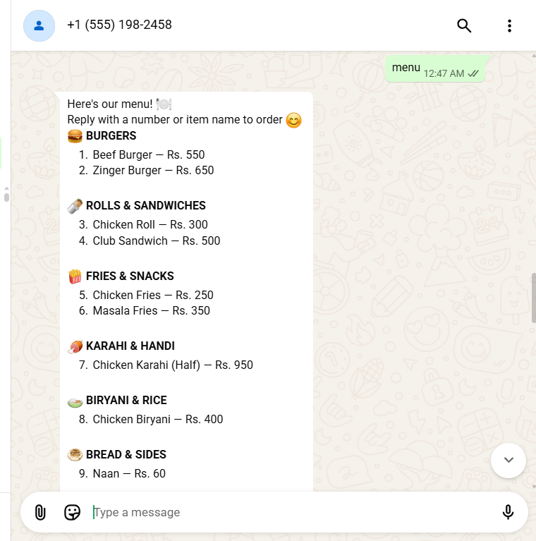 | **Price question**<br>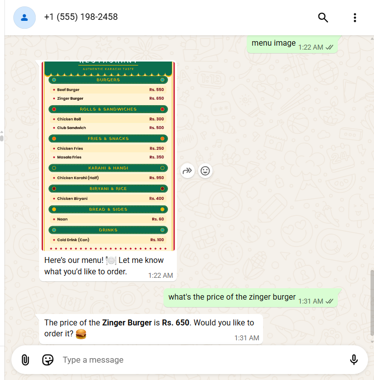 |
| **Ambiguous item: the bot asks which one**<br>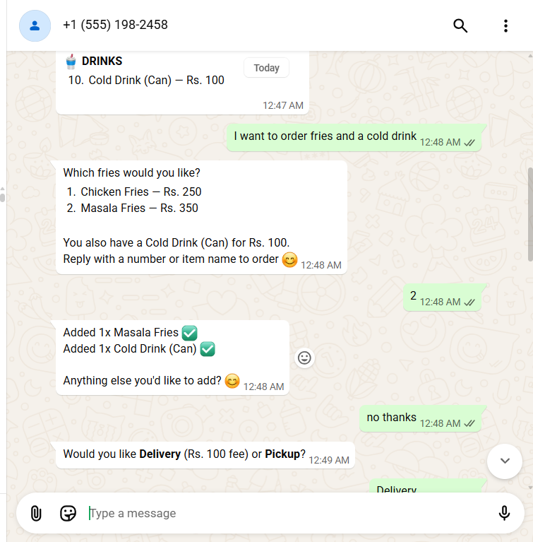 | **Ordering a deal** (earlier, larger demo menu)<br>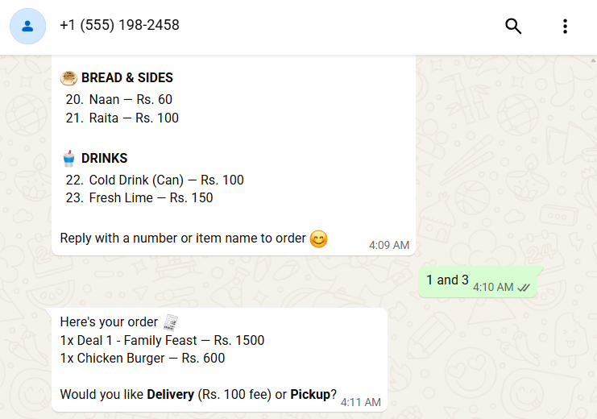 |
| **Order summary before confirming**<br>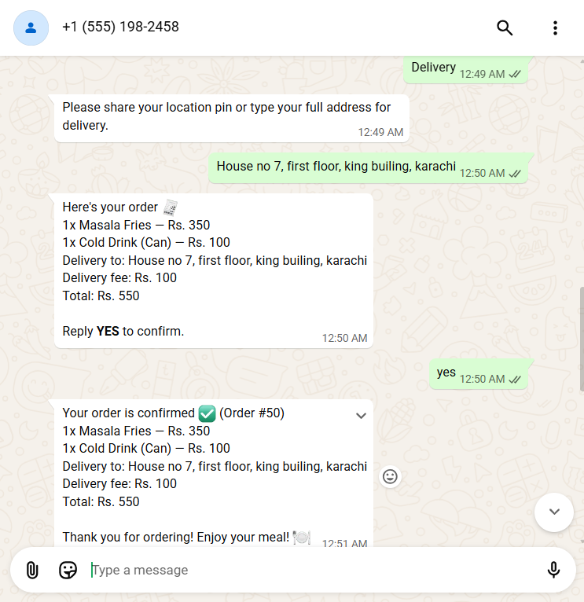 | **Confirmation and status updates**<br>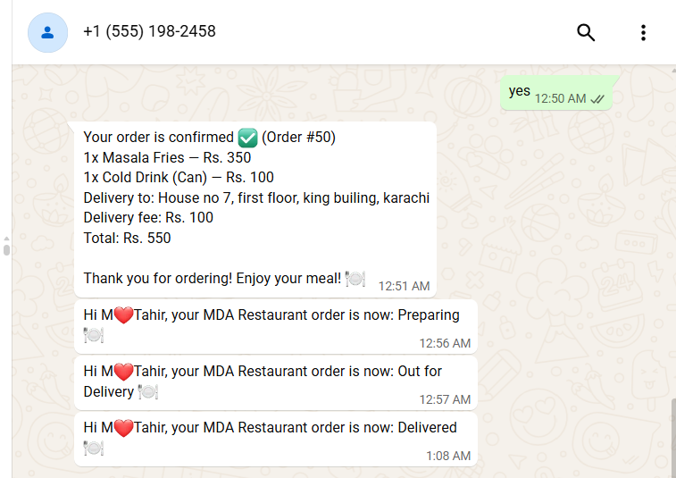 |
| **Owner approves a menu change in WhatsApp**<br>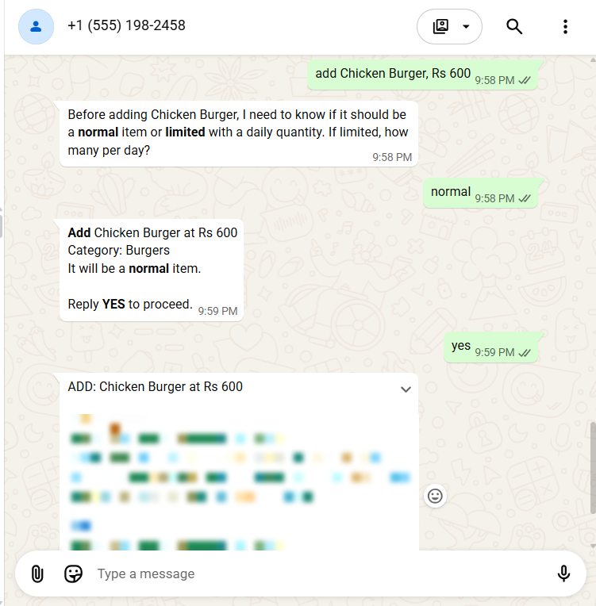 | **Auto-generated menu image**<br>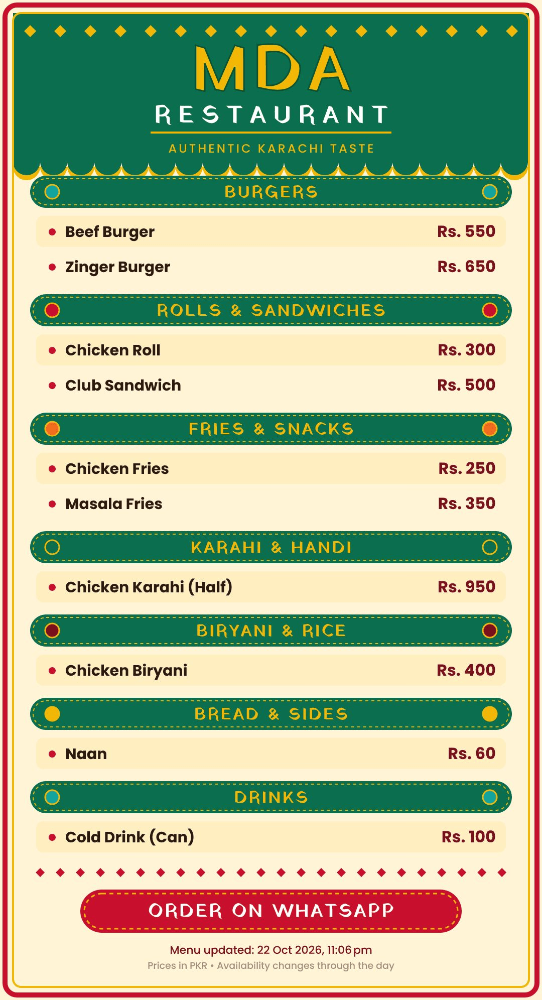 |
| **Owner email for a new order**<br>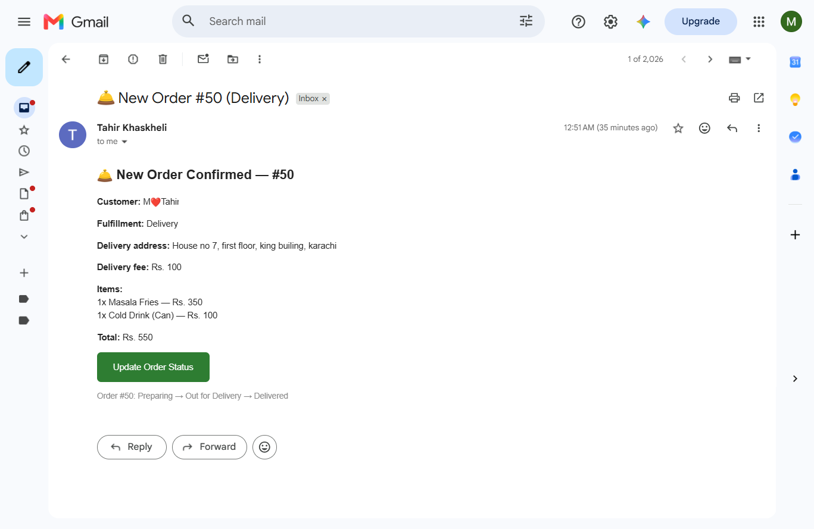 | **Owner updates order status (form)**<br>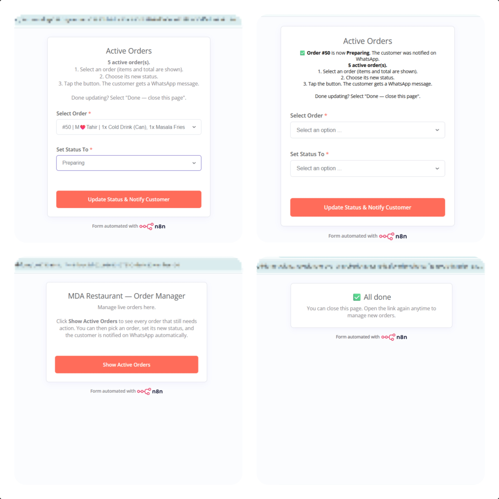 |

**n8n canvas (main agent workflow)**

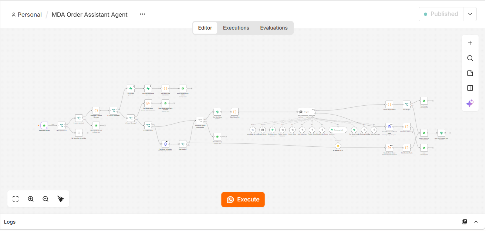

## Architecture

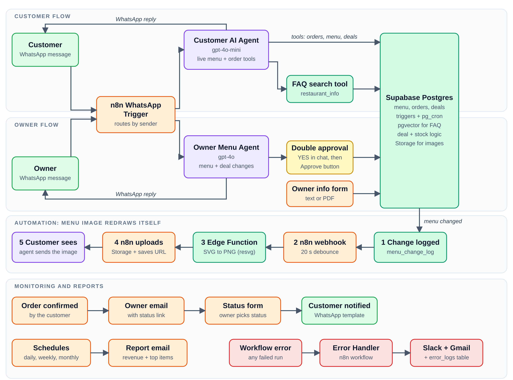

| Layer | Tech |
|---|---|
| Workflows and agents | n8n (AI Agent, tool sub-workflows, WhatsApp HITL, Form trigger) |
| Models | OpenRouter (gpt-4o-mini, customer) and OpenAI (gpt-4o, owner) |
| Database | Supabase Postgres (triggers, pg_cron, pg_net, pgvector for FAQ search) |
| Image | Supabase Edge Function (Deno, resvg-wasm, Poppins and Yatra One fonts) |
| Channel | WhatsApp Cloud API |

## Design decisions worth reading

- **Deterministic where it matters.** The LLM never decides prices, stock or menu numbers. Prices and stock come from the database. A code step rewrites any price the model types. Menu numbers ("3") are resolved in code to the same list the customer saw.
- **The menu text is built in code**, not by the model, and passed in with an instruction to copy it. A cleanup step removes stray markers and duplicate stock notes.
- **Deals are menu rows** (`is_deal`) plus `deal_items`, so ordering, stock and the menu reuse the normal item flow. Deal availability and stock are derived from components by `refresh_deals`.
- **Soft delete:** removed items are archived, so old orders keep their history.
- **Categories are a database column** (`menu_items.category`) shared by the image, the text menu and the owner agent.

## Repository layout

```
supabase/schema.sql                       reference schema, functions, triggers, cron job
supabase/functions/generate-menu-image/   edge function + SVG menu builder
n8n/                                      workflow exports (sanitized) and how to export them
scripts/sanitize_workflows.py             strips credentials and secrets from workflow JSON
assets/menu-preview.png                   example output
```

## Setup (outline)

1. Create a Supabase project, enable `pgvector`, `pg_net`, `pg_cron`, and run `supabase/schema.sql` (set your n8n webhook URL and secret in `notify_menu_image_refresh`).
2. Create a public Storage bucket `restaurant-assets`. Deploy the Edge Function (`supabase functions deploy generate-menu-image`).
3. Import the n8n workflows, add credentials (Supabase, WhatsApp Cloud API, OpenRouter, OpenAI) and set your owner WhatsApp number in the owner checks and approval nodes.
4. Point the WhatsApp Cloud API webhook at the n8n trigger, publish the workflows, and message the number.

## Known limits

- Menu numbers shift when the menu changes mid-conversation; the bot always names what it added so mistakes are visible.
- Category order is defined in three places (image function, menu text step, add-item workflow). Keep them in sync.
- Items cannot be removed from an order by the bot; it hands over to the owner's phone number.
- Reference schema omits row-level-security policies and some constraints.

## Author

Muhammad Tahir  n8n automation developer, Karachi · [github.com/mtahir-ds](https://github.com/mtahir-ds) · [linkedin.com/in/muhammad-tahir-data](https://linkedin.com/in/muhammad-tahir-data)
